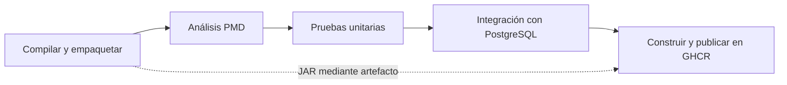

# Ecommerce: integración continua

Actividad implementada en el fork de [Angel101111](https://github.com/Angel101111/acm_ecommerce_java_avanzado).
El workflow [.github/workflows/build-app.yaml](.github/workflows/build-app.yaml) se activa
al abrir o actualizar un Pull Request hacia `main` o `master`. También permite ejecución manual.



Cada etapa tiene su propio job y runner. `needs` impide construir o publicar la imagen
si fallan el análisis o las pruebas. No se despliega la aplicación.

| Job | Validación o resultado |
| --- | --- |
| `build` | Temurin 25, caché de Gradle, `clean bootJar` y artefacto `app-jar`. |
| `static-analysis` | PMD 7.28.0 sobre el código de producción; infracciones bloquean el pipeline. |
| `unit-test` | `test`: Mockito y JUnit, sin servidor ni base de datos. |
| `integration-test` | `integrationTest`: contexto Spring, persistencia de pedidos, inventario y borrado lógico con PostgreSQL 17 real. |
| `docker` | Descarga el JAR, construye el Dockerfile con Java 25 y publica dos etiquetas en GHCR. |

Se conserva el JAR durante siete días. Los reportes XML/HTML de PMD y las pruebas se
guardan incluso si esas tareas fallan. Solo `docker` tiene `packages: write`;
los demás jobs tienen únicamente `contents: read`. Los checkouts no conservan credenciales.
Las ejecuciones anteriores de un mismo PR se cancelan al recibir cambios nuevos.
Las acciones de checkout, Java, artefactos y Docker utilizan versiones con Node.js 24.

## Dos apartados adicionales elegidos

1. **Análisis estático:** PMD, herramienta de código abierto integrada mediante el plugin
   oficial de Gradle. [El ruleset](config/pmd/ruleset.xml) detecta recursos sin cerrar,
   capturas vacías de excepciones, errores de comprobación de nulos, código sin uso y
   complejidad excesiva. `ignoreFailures = false` hace que los hallazgos impidan publicar.
2. **Etiquetado por revisión:** se publican `latest` y `sha-<7 caracteres>`.
   El nombre se normaliza a minúsculas: `ghcr.io/angel101111/acm_ecommerce_java_avanzado`.
   Se usa el SHA del commit que realmente valida el checkout; en un PR es el commit
   de merge generado por GitHub, visible en la ejecución. La etiqueta permite recuperar
   esa imagen para un rollback.

`latest` corresponde a la última ejecución que logró publicar, incluso con un PR aún
abierto, de acuerdo con esta actividad. No representa una versión fusionada ni producción.
CodeQL y Trivy pertenecen al tercer apartado opcional, que no se eligió.

## Configurar los secretos del fork

En **Settings → Secrets and variables → Actions → New repository secret**, crear:

| Secret | Valor para el entorno efímero de CI |
| --- | --- |
| `DB_NAME` | Nombre de la base de pruebas, por ejemplo `ecommerce_ci`. |
| `DB_USER` | Usuario exclusivo de pruebas. |
| `DB_PASSWORD` | Contraseña exclusiva de pruebas. |
| `DB_PORT` | Puerto del runner, por ejemplo `5434`, como en el archivo del ejercicio. |
| `SPRING_DATASOURCE_URL` | `jdbc:postgresql://localhost:<DB_PORT>/<DB_NAME>`; reemplazar ambos marcadores por los valores de sus secretos. |
| `SPRING_DATASOURCE_USERNAME` | El mismo valor de `DB_USER`. |
| `SPRING_DATASOURCE_PASSWORD` | El mismo valor de `DB_PASSWORD`. |

Estas variables se inyectan únicamente en el job de integración y en su servicio
PostgreSQL. El workflow valida su coherencia sin imprimir valores. El perfil `test`
crea y elimina el esquema: utilizar exclusivamente una base desechable de pruebas.
La aplicación ya no contiene credenciales de conexión en `application.yaml`.

Por ejemplo, `DB_NAME=ecommerce` y `DB_PORT=5434` requieren la URL
`jdbc:postgresql://localhost:5434/ecommerce`. Docker publica el puerto elegido del
runner hacia el puerto interno `5432` de PostgreSQL; ambos puertos pueden ser distintos.

El contenedor se inicia en un paso después de validar los secretos, espera a estar
`healthy` y comprueba una conexión autenticada con `SELECT 1` antes de las pruebas.
Si el arranque falla, muestra los logs de PostgreSQL; al terminar el job elimina el
contenedor, incluso si las pruebas fallan. Los informes de integración solo se suben
cuando existen resultados XML, para evitar advertencias si las pruebas no llegaron a iniciar.

`GITHUB_TOKEN` se proporciona automáticamente; no se necesita guardar un token personal
para publicar. No subir `.env`, `envejemplo`, claves SSH ni contraseñas al repositorio.
El contexto de Docker contiene únicamente el JAR y el Dockerfile.

El PR de la entrega debe nacer de una rama **del mismo fork**. En PR procedentes de
repositorios externos se omiten integración y publicación porque no reciben secretos.
No se utiliza `pull_request_target` para ejecutar código de un PR con permisos elevados.

## Pruebas locales

Requisitos: JDK 25, acceso a los repositorios de dependencias y Docker para PostgreSQL.

```bash
bash ./gradlew --no-daemon clean bootJar pmdMain test
```

Para integración, configurar las siete variables anteriores en el entorno de la terminal
con valores de pruebas. Luego iniciar una base desechable:

```bash
docker run --detach --rm --name ecommerce-ci-postgres \
  --publish "127.0.0.1:${DB_PORT}:5432" \
  --env POSTGRES_DB="$DB_NAME" \
  --env POSTGRES_USER="$DB_USER" \
  --env POSTGRES_PASSWORD="$DB_PASSWORD" \
  --health-cmd 'pg_isready -h 127.0.0.1' \
  --health-interval 2s --health-timeout 5s --health-retries 30 \
  postgres:17-alpine
```

Esperar a que `docker inspect --format '{{.State.Health.Status}}' ecommerce-ci-postgres`
indique `healthy`, y ejecutar:

```bash
bash ./gradlew --no-daemon integrationTest
docker build --tag ecommerce-ci:local .
docker stop ecommerce-ci-postgres
```

`src/test` contiene tres pruebas unitarias de pedidos: total y reducción de existencias,
rechazo por inventario insuficiente y producto inexistente. `src/integrationTest`
contiene tres pruebas: arranque del contexto, persistencia de pedidos y borrado lógico.
Ambas suites se ejecutan en tareas y jobs distintos. `check` incluye las dos suites.

El proyecto conserva Spring Boot 4.0.5 y el toolchain Java 25 del repositorio original.
Se sustituyeron las declaraciones duplicadas de Springdoc 2.x por 3.0.3, compatible
con Spring Boot 4.0.x, y se añadió explícitamente el starter de pruebas.

## Entrega

Habilitar GitHub Actions en el fork si GitHub lo solicita y permitir la publicación de
paquetes en la configuración de la cuenta/repositorio. Subir `feature/ci-pipeline` y
abrir el Pull Request hacia **`Angel101111/acm_ecommerce_java_avanzado:main`**.
No abrirlo hacia el repositorio original del profesor.

Comprobar que los cinco jobs terminan en verde, que aparecen los tres reportes y el
artefacto JAR, y que GHCR contiene `latest` y `sha-…`. Adjuntar el enlace al fork y al PR
con su ejecución. La presencia de estos archivos por sí sola no demuestra una ejecución
correcta; la evidencia final es la ejecución real en GitHub Actions.

## Documentación oficial

- [Configurar Java y caché Gradle](https://github.com/actions/setup-java).
- [Plugin PMD de Gradle](https://docs.gradle.org/current/userguide/pmd_plugin.html).
- [Reglas Java de PMD](https://docs.pmd-code.org/latest/pmd_rules_java.html).
- [Separar pruebas de integración con Gradle](https://docs.gradle.org/current/userguide/java_testing.html#sec:configuring_java_integration_tests).
- [Secrets en GitHub Actions](https://docs.github.com/en/actions/how-tos/write-workflows/choose-what-workflows-do/use-secrets).
- [Publicar imágenes en GHCR](https://docs.github.com/en/actions/tutorials/publish-packages/publish-docker-images).
- [Compatibilidad Springdoc y Spring Boot](https://springdoc.org/#what-is-the-compatibility-matrix-of-springdoc-openapi-with-spring-boot).
